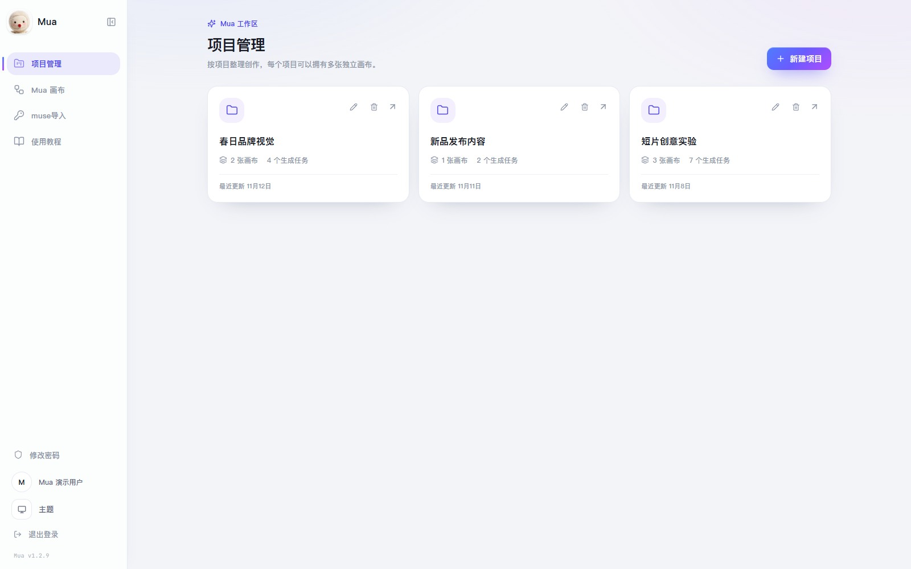
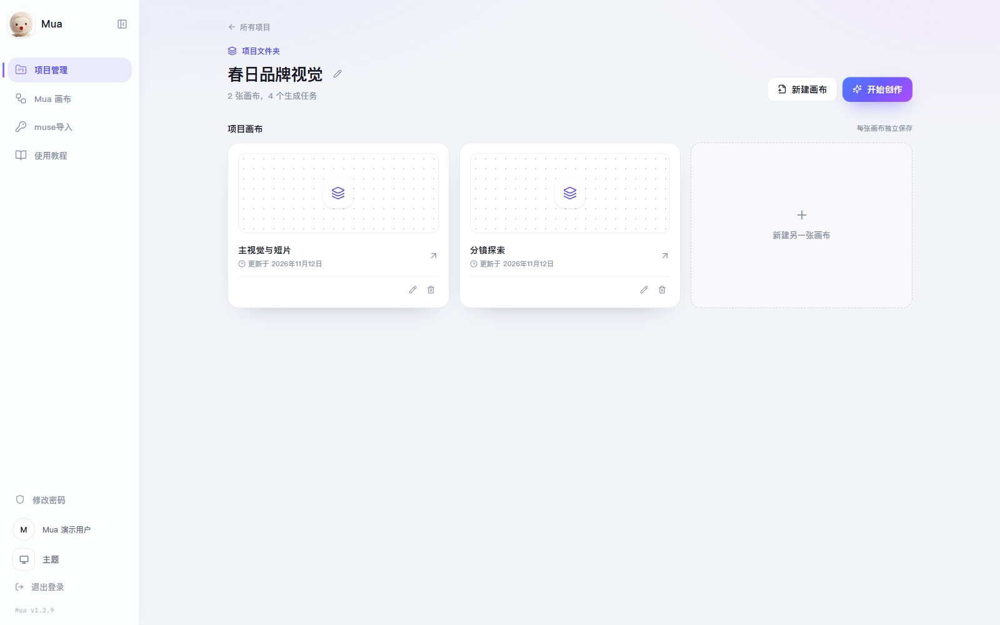
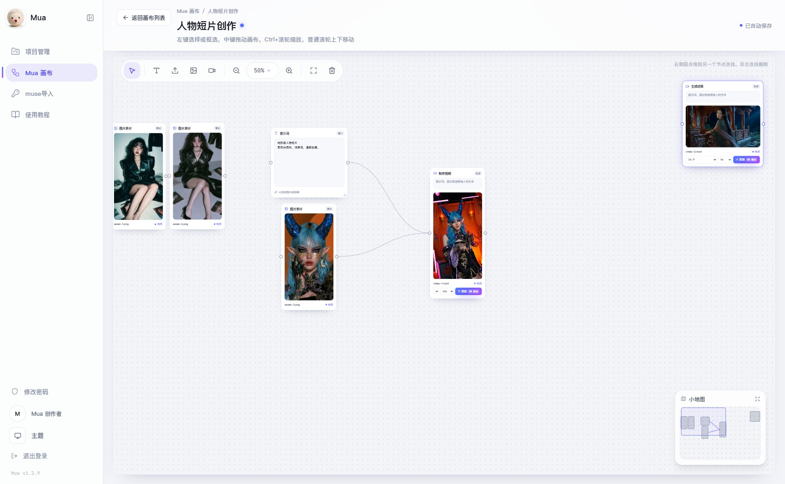
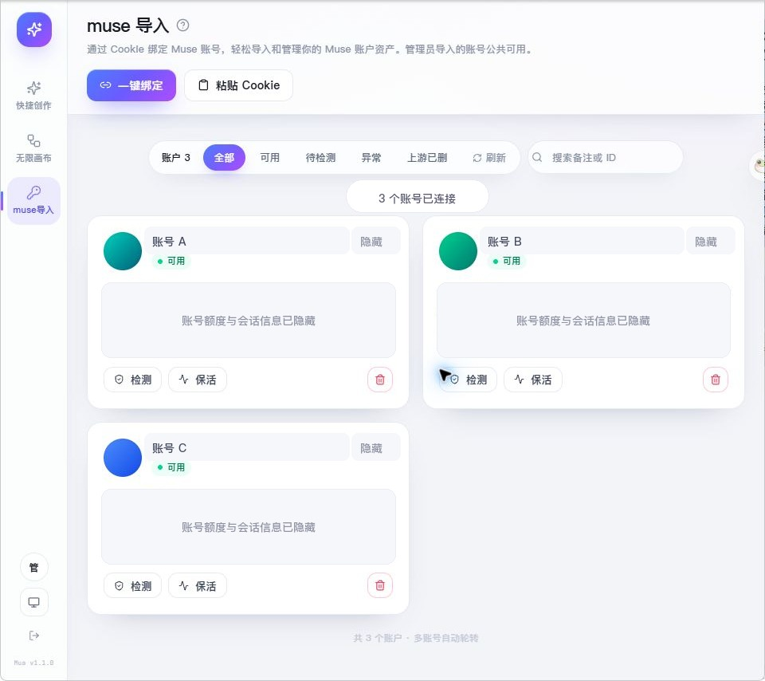

# Mua · AI 图片与视频创作平台

把 **muse.ai** 的网页端能力包装成可自托管的图片与视频创作站：导入 muse 账号 → 用账号池额度生成图片和视频 → 在画布上编排。全部跑在本机，不依赖第三方云服务。

上游复用开源项目 [muse2api](https://github.com/czg86389-hub/muse2api)（把 muse.ai 逆向封成 OpenAI 兼容 API，靠无头 Chrome + CDP 驱动网页端）。本仓库在它之上补了平台层。

当前产品版本为 **Mua v1.2.9**，扩展版本为 **1.0.3**。详细更新记录见 [CHANGELOG.md](CHANGELOG.md)。

```
┌──────────────┐   HTTP    ┌─────────────────┐   HTTP    ┌──────────────┐  CDP  ┌────────┐  HTTPS  ┌──────────┐
│  浏览器 web/  │ ────────► │ 平台 server/     │ ────────► │ 上游 muse2api │ ────► │ Chrome │ ──────► │ muse.ai  │
│  React SPA   │   :8787   │ Node + SQLite    │  :18610   │ FastAPI      │ :19210│ 无头   │         │ 网页端    │
└──────────────┘           │ 任务/账号/作品    │           │ 账号池/生成   │       └────────┘         └──────────┘
                           └─────────────────┘           └──────────────┘
```

- **上游**：负责「怎么让 muse.ai 真的生成出东西」——浏览器驱动、Cookie 会话、附件上传、结果抓取。
- **平台**：负责「怎么用得顺」——登录、账号导入与额度、任务编排、画面预览、画布。

两层解耦。升级上游只需 `cd upstream/muse2api && git pull`，不影响平台代码。

---

## 产品界面截图

以下为 Mua v1.2.9 当前界面的浏览器截图。项目管理、项目画布列表和账号页面使用演示数据。Mua 画布截图取自实际创作画布，并使用真实生成的图片与视频；公开展示前已将提示词、项目名称、媒体文件名和个人资料替换为通用内容。

<table>
  <tr>
    <td align="center">
      <br>
      <b>项目管理</b> · 每个项目文件夹独立管理画布和生成任务
    </td>
    <td align="center">
      <br>
      <b>项目画布列表</b> · 一个项目内建立多张独立画布
    </td>
  </tr>
  <tr>
    <td width="50%" align="center">
      <br>
      <b>Mua 画布</b> · 图片、视频、提示词节点与连线工作流
    </td>
    <td width="50%" align="center">
      <br>
      <b>Muse 账号管理</b> · 绑定入口、状态筛选与额度卡片，内容为虚构演示数据
    </td>
  </tr>
</table>

---

## 快速开始

### 环境

- Windows 10/11（也支持 Linux / macOS；启停脚本目前是 PowerShell）
- Node.js 20+（本机实测 24.13）
- Python 3.11（`upstream/muse2api`）
- Chrome（装在默认路径即可，上游会自动探测）

### 克隆与启动

```powershell
git clone https://github.com/Toshio0o/Mua.git
cd Mua

.\start.ps1          # 启动上游 + 平台
.\start.ps1 -Build   # 改过前端后，先构建再启动
.\stop.ps1           # 全部停止
```

首次运行会自动创建 Python venv、安装依赖、打包扩展，等它跑完即可。

首次启动前，请分别参考 `server/.env.example` 和 `upstream/muse2api/.env.example` 创建本地 `.env`，填入自己的密钥。首次创建管理员时，密码至少 12 个字符；`JWT_SECRET` 至少 32 个随机字符。

### 打开

| 入口 | 地址 |
|---|---|
| 平台 | <http://127.0.0.1:8787> |
| 上游面板（调试用） | <http://127.0.0.1:18610/admin> |

管理员账号由 `server/.env` 中的 `ADMIN_EMAIL` 与 `ADMIN_PASSWORD` 首次创建。上游面板密钥使用 `upstream/muse2api/.env` 中配置的 `MUSE2API_KEY`。仓库不提供默认登录凭据。

---

## 功能

| 功能 | 路由 | 说明 |
|---|---|---|
| **项目管理** | `/projects` | 创建、重命名和删除项目文件夹；每个项目可管理多张画布和生成任务 |
| **Mua 画布** | `/scratch`、`/canvas/:canvasId` | 零散画布或项目画布；节点工作流、单节点图片与视频生成、跨画布复制、自动保存 |
| **Muse 导入** | `/accounts` | 一键绑定或粘贴 Cookie；额度查询、检测、保活和删除 |

登录后进入「项目管理」。旧 `/create` 地址会跳转至项目管理。「Mua 画布」用于独立的零散创作。

> 其余页面（首页、论坛、会员、充值、邀请、团队、API 平台、设置、历史、运营后台）已下线，源码仍在 `web/src/pages/`。需要时在 `App.jsx` 里加回 import 和 Route 即可。

---

## 账号导入（重点）

**没有导入账号，平台什么都生成不了。** 平台本身不产生内容，只是把你的 muse.ai 账号变成可调用的生成能力——每次点「生成」，上游都会用你导入的账号去 muse.ai 网页端跑一遍。

### 为什么不能直接复制 Cookie

muse.ai 的登录态主要靠 `hatch_sess`，它是 **HttpOnly** Cookie：

- 在页面里执行 `document.cookie` —— **读不到它**
- DevTools → Application 能看到它，但那是浏览器内部视图，网页 JS 访问不到

想拿到它，只有三条路：**浏览器扩展**（能读 HttpOnly）、**从网络请求头里抄**、或 **让上游自己的浏览器登录一次**。下面三种导入方式对应这三条路。

### 三种方式对比

| 方式 | 是否手拷 Cookie | 需要什么 | 适合 |
|---|---|---|---|
| **一、一键绑定**（推荐） | 不用 | 装一次浏览器扩展 | 日常使用，最省事 |
| **二、手动粘贴** | 要，从 Network 面板抄 | 会用 DevTools | 不想装扩展，或临时加号 |
| **三、上游面板直连** | 不用 | 上游 key | 调试，或用上游自带导号工具 |

---

### 方式一：一键绑定（推荐）

原理：平台页面生成一次性绑定码 → 扩展在浏览器里读出 muse.ai 的全部 Cookie（含 HttpOnly）→ 提交给平台 → 平台转给上游入库。

#### 第 1 步：安装扩展（只需一次）

1. 打开平台 → 左侧 **muse 导入** → 点右上角 **「一键绑定」**
2. 在弹窗里展开「还没装扩展？」，点 **「下载扩展包 (.zip)」**  
   （也可以直接用仓库里的 `extension/` 目录）
3. 解压到一个**不会被删**的固定位置
4. Chrome 地址栏输入 `chrome://extensions`
5. 打开右上角 **「开发者模式」**
6. 点 **「加载已解压的扩展程序」**，选刚才解压出来的文件夹
7. 工具栏出现扩展图标即成功

> 更新过扩展代码后，要回 `chrome://extensions` 点一次「重新加载」，否则浏览器还在跑旧代码。

#### 第 2 步：确保这个浏览器已登录 muse.ai

打开 <https://muse.ai/>，能看到聊天界面即可。

**扩展读的是「你点绑定按钮的那个浏览器」里的登录态，不是服务器上的。** 若在 A 电脑装扩展、在 B 电脑登录 muse.ai，绑不上。

#### 第 3 步：绑定

两种走法任选其一：

**走法 A（自动）**

1. 平台点 **「一键绑定」** → 生成绑定码
2. 点弹窗里的 **「打开」**（跳到 `/bind/<码>`）
3. 扩展检测到绑定码 → 自动读 Cookie → 提交 → 页面显示「绑定成功」

**走法 B（手动填码，适合给第二个账号用）**

1. 平台点 **「一键绑定」**，复制 **绑定码**
2. 点浏览器工具栏的扩展图标
3. 三个框这样填：

   | 框 | 填什么 |
   |---|---|
   | 平台地址 | `http://127.0.0.1:8787`（部署在服务器就填服务器地址） |
   | 绑定码 | 刚才复制的那个 |
   | 备注名 | 随便，比如「主号」，可留空 |

4. 点 **「读取并绑定」**

> 绑定码 **20 分钟有效**，且只能用一次。过期了就回平台重新点「一键绑定」。多账号请各自生成新码。

#### 一键绑定失败排查

| 提示 | 原因 | 怎么办 |
|---|---|---|
| 没有读到 Cookie | 当前浏览器没登录 muse.ai | 先登录再试 |
| 读到 N 条但没有 hatch_sess | 登录态不对或已失效 | 重新登录 muse.ai |
| 该绑定码已使用过 | 重复提交 | 重新生成一个码 |
| 绑定码已过期 | 超过 20 分钟 | 重新生成一个码 |
| 扩展没有响应 | 扩展被禁用 / 页面没刷新 | 在 `chrome://extensions` 确认已启用，再刷新页面 |

---

### 方式二：手动粘贴 Cookie

不想装扩展，或只想临时加个账号时用这个。

#### 需要哪些 Cookie

| Cookie | 必要性 | 说明 |
|---|---|---|
| **`hatch_sess`** | **必须有** | 登录会话本身，缺它平台会直接拒绝 |
| `hatch_vml` | 强烈建议 | 决定账号剩余有效期（约 48 小时） |
| `hatch_gw` | 可选 | 路由缓存，上游会自己重新签发 |
| 其他（`datr`、`dpr`、`theme`、`wd`、`_fbp`…） | 不需要 | 与登录态无关 |

#### ✅ 推荐：从 Network 面板复制完整 Cookie 头

一次复制全部，格式天然正确，最不容易出错。

1. 在已登录 muse.ai 的标签页按 `F12`
2. 切到 **Network**
3. 按 `F5` 刷新
4. 点任意一条发往 `muse.ai` 的请求（例如 `graphql`）
5. 右侧 **Headers** → **Request Headers**
6. 找到以 `cookie:` 开头的那一行
7. **右键 → Copy value**
8. 回到平台 → 「muse 导入」→ **「粘贴」** → 粘贴 → 起备注名 → 导入

复制出来大概长这样：

```
hatch_sess=eyJhbGciOi...; hatch_vml=v1%3A...; hatch_native_auth_device=...; datr=...; _fbp=...
```

#### ❌ 不推荐：在 Application → Cookies 表格里逐个复制

能用，但容易出错：

1. 表格里的值常被截断，`hatch_sess` 可能要往下滚才看得见
2. 点 Value 只能一次复制一个，还得自己补 `名字=` 前缀、拼分号
3. 漏掉 `hatch_vml` 会让有效期估算不准

如果只能从表格抄，最少要这两个，并手工拼成：`hatch_sess=值; hatch_vml=值`

- `hatch_sess`（表格里可能显示成 `hatch_s...`，800+ 字节的那行）
- `hatch_vml`（紧挨着的下一行）

#### 粘贴时的容错

平台解析比较宽松，下面这些都能吃：

- 带 `Cookie:` 前缀 → 自动去掉
- 多行粘贴 → 自动合并成 `; ` 分隔
- 从表格复制的制表符分隔 → 一般也能识别

但**只复制 Value、不带名字**不行，必须有 `hatch_sess=` 前缀。

---

### 方式三：上游面板直连

也可以在上游管理页直接导号：<http://127.0.0.1:18610/admin>

- **Chrome 扩展**：`upstream/muse2api/extension/`，填服务地址 `http://127.0.0.1:18610` + Key
- **油猴脚本**：`upstream/muse2api/tools/muse2api_cookie_importer.user.js`

这种方式导入的账号归属为空，即「公共池」，平台上所有用户共用。

---

### 账号管理

#### 状态含义

| 状态 | 含义 |
|---|---|
| 可用（绿） | 最近一次检测通过 |
| 待检测（黄） | 刚导入，还没验证过 |
| 异常（红） | 检测失败，多半是 Cookie 过期 |
| 上游已删 | 上游账号池里没有了（在别处删过） |

#### 额度

导入后点账号卡片上的 **「点此查询」**（或页面顶部「刷新」的额度汇总），平台会调上游打开浏览器去 muse.ai 设置页读一次额度，返回：

- **周额度已用百分比**（muse 免费版按周限额）
- **重置日期**
- **额外额度**（通常是「剩余 xx 亿个词元」）

顶栏 `1 账号 · 剩 60%` 就来自这里。多账号时显示平均值；账号页另有「额度合计」（各账号余量相加，例如三个账号剩 60/40/20% → 合计 120%）。

> 额度**不会自动刷新**——查询要开浏览器读页面，比较重。因此是手动触发 + 60 秒本地缓存。

#### 有效期

muse 会话约 **48 小时**。到期后：

- 账号状态会变成「异常」
- 生成请求会返回 401

重新导入一次即可。点 **「保活」** 可让上游尝试续期（不保证成功，取决于上游是否重新签发）。

#### 多账号

账号池按「最久未用」自动轮转，互不阻塞。给每个账号单独生成绑定码即可。

---

## 使用

### 项目管理 `/projects`

1. 进入「项目管理」，点击「新建项目」创建文件夹。
2. 打开文件夹后，可以新建多张画布，或点击「开始创作」进入主画布。
3. 项目文件夹可重命名或删除。删除文件夹会删除里面的画布内容，生成任务与结果会留在作品记录中。
4. 「Mua 画布」入口保留给零散创作，与项目文件夹中的画布分开保存。

操作方式变化：原来的「快捷创作」入口已经移除，旧 `/create` 地址会跳转到项目管理。现在从项目文件夹进入对应画布创作；每张画布和视口会自动保存到服务端，并与所属项目及生成任务关联。

### Mua 画布 `/canvas/:canvasId`

画布以节点组织提示词、图片素材、图片生成和视频生成。选中或双击空白处可添加节点；拖动节点侧边圆点连接节点。连接线拖到空白处会弹出节点选择菜单。生成节点可以单独选择图片或视频比例，视频节点还能选择 5、6、8 或 10 秒时长。

当前鼠标操作如下：

| 操作 | 效果 |
|---|---|
| 左键点击节点 | 选择节点；拖动节点可移动 |
| 左键拖动画布空白处 | 框选节点 |
| Shift 加左键 | 追加或取消选择；Shift 框选可追加节点 |
| 右键点击节点 | 选择节点；右键拖动不移动节点 |
| 按住鼠标中键拖动 | 平移画布 |
| 普通滚轮 | 上下移动画布 |
| 在画布内按住 Ctrl 滚动滚轮 | 缩放画布，浏览器页面保持原缩放 |
| 双击画布空白处 | 打开节点选择菜单 |
| Delete / Backspace | 删除选中的节点或连线 |
| Esc | 清除选择并关闭节点菜单 |
| Ctrl+C / Ctrl+V | 复制和粘贴选中的节点；可在同一账号的不同画布间使用 |

图片和视频可以拖入画布，也可以从剪贴板粘贴。节点、连线和视口更改会自动保存。缩放也可使用画布工具栏的加减按钮。

### 账号、主题与侧栏

- 在「Muse 导入」使用「一键绑定」生成一次性绑定码，再到已登录 Muse 的 Chrome 或 Edge 打开绑定页，由 Mua 扩展读取登录状态。也可手动粘贴 Cookie。
- 多个 Muse 账号可重复绑定。账号卡片可查看状态、查询额度、检测、保活或删除。
- 侧栏支持展开与收起；主题支持跟随系统、浅色和深色；头像可从侧栏上传；管理员可从侧栏修改密码。
- 「使用教程」入口也在侧栏，含画布操作说明与快捷键。

---

## 目录结构

```
museAPI-video/
├── start.ps1 / stop.ps1     一键启停
├── extension/               浏览器扩展（一键绑定）
│   ├── manifest.json
│   ├── background.js        读 muse.ai Cookie → POST /api/accounts/bind
│   ├── content.js           在 /bind/<码> 页面自动触发
│   └── popup.html/js        手动填码入口
├── upstream/muse2api/       上游引擎（Python FastAPI，未改动）
│   ├── .env                 上游配置（KEY / Chrome 路径 / 超时）
│   └── .venv/
├── server/                  平台后端（Node + SQLite）
│   ├── .env                 JWT / 上游地址 / 管理员
│   ├── public/              扩展打包下载
│   ├── data/                SQLite、媒体、上传（备份就打包这个）
│   └── src/
│       ├── index.js         入口
│       ├── db.js            表结构与读写
│       ├── muse.js          上游客户端
│       ├── auth.js          登录
│       ├── worker.js        任务轮询 + 队列调度
│       └── routes/          auth / accounts / generate / queue / chat …
└── web/                     前端（React + Vite + Tailwind）
    ├── public/fonts/        自托管字体
    └── src/pages/           Create / Canvas / Accounts / Login / Bind
```

---

## 配置

`server/.env`：

| 变量 | 默认 | 说明 |
|---|---|---|
| `PORT` | 8787 | 平台端口 |
| `MUSE_BASE` | `http://127.0.0.1:18610` | 上游地址 |
| `MUSE_KEY` | 与上游配置相同 | 上游访问密钥，请自行生成并配置 |
| `ADMIN_EMAIL` / `ADMIN_PASSWORD` | 自行设置 | 首次启动创建的管理员 |
| `JWT_SECRET` | 随机 | 登录签名密钥，**生产必换** |

`upstream/muse2api/.env`：

| 变量 | 默认 | 说明 |
|---|---|---|
| `MUSE2API_CHROMIUM` | 自动探测 | Chrome 路径 |
| `MUSE2API_VIDEO_TIMEOUT` | 900 | 视频生成超时（秒） |
| `MUSE2API_CONCURRENCY` | 2 | 最大并发任务数 |

---

## 常见问题

**Q：导入成功了，但点生成提示「没有可用账号」**  
上游账号池为空，或账号状态是「异常」。去 muse 导入页看卡片状态，点「检测」确认。

**Q：DevTools 的 Cookies 里找不到 `hatch_sess`**  
表格按字母排序，`hatch_sess` 在 `hatch_gw`、`hatch_native_auth_device` 下面，往下滚。若确实没有，说明这个浏览器没有登录成功。

**Q：`document.cookie` 里没有 `hatch_sess`**  
正常。它是 HttpOnly，JS 读不到。用 Network 面板或扩展。

**Q：生成一直卡在「生成中」**  
上游在跑浏览器，第一次启动 Chrome 会慢一些。超过 15 分钟会自动判失败并退还。若一直不动，看 `upstream/muse2api/server.log`。

**Q：账号只用了几天就「异常」了**  
muse 会话约 48 小时，属正常。重新绑定即可。

**Q：部署到服务器后打不开或 401**  
检查 `server/.env` 的 `MUSE_BASE` 是否指向上游；Nginx 反代建议放大超时并关闭 buffering：

```nginx
location / {
    proxy_pass http://127.0.0.1:8787;
    proxy_read_timeout 600s;
    proxy_send_timeout 600s;
    proxy_buffering off;
    client_max_body_size 200M;
}
```

**Q：扩展旧版还能用吗**  
扩展使用兼容通信标识 `museapi-video-ext`。装过旧版的，请在 `chrome://extensions` 点一次「重新加载」，或删掉后重新加载新目录。

---

## 排错时看哪里

| 文件 | 内容 |
|---|---|
| `server/server.log` | 平台日志（任务轮询、队列调度） |
| `server/server.err.log` | 平台异常 |
| `upstream/muse2api/server.log` | 上游日志（浏览器、生成） |
| `upstream/muse2api/server.err.log` | 上游异常 |

平台数据库：`server/data/studio.db`（SQLite）。账号、任务、队列都在这里。

一键体检：

```powershell
node scripts/acceptance.mjs            # 路由 + 接口 + 鉴权边界
node scripts/test-bind.mjs             # 一键绑定链路
node scripts/test-extension-logic.mjs  # 扩展逻辑（沙箱执行 background.js）
```

---

## 许可与致谢

- 特别感谢 [LIUFelix2004](https://github.com/LIUFelix2004) 发布 [museAPI-video 初版](https://github.com/LIUFelix2004/museAPI-video)。Mua 从他的初版项目发展而来，并在此基础上持续演进界面、项目管理、画布工作流、账号管理与品牌设计。
- 上游引擎：[muse2api](https://github.com/czg86389-hub/muse2api)
- 本仓库平台层按仓库内文件约定使用；对外部署请自行遵守 muse.ai 服务条款
